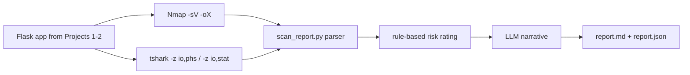

# Architecture — Threat Narrative Scanner

## Components

- `app/` — the Project 1 Flask app, copied in as the scan target.
  It is scanned, not modified, by this project.
- `scan_report.py` (Day 2–5) — parse Nmap XML into structured JSON
  (host, open ports, service, version, state); extract tshark stats
  (protocol breakdown, top talkers — no packet payloads stored);
  rate each open port Critical / High / Medium / Low from service +
  exposure; generate the narrative.
- `data/sample_nmap.xml` — a small sample scan of localhost for tests,
  so CI runs without nmap installed. No live scan in CI.
- `tests/test_scan_report.py` (Day 2–4) — parser tests on the sample
  XML, risk rating tests, report-shape tests.

## Decisions

- **Ratings are rule-based first.** The LLM only writes the narrative;
  it does not decide the rating. A database port open to the world is
  Critical because a rule says so, not because a model felt like it.
- **No packet payloads stored.** tshark stats only — protocol
  breakdown and top talkers.
- **Scan only your own app.** Localhost, or the user's own free-tier
  host. Never a third-party host.
